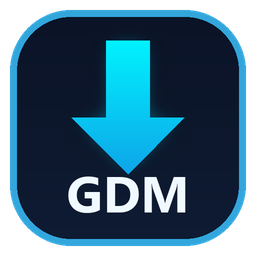

# GDM — Gomaa Download Manager

**برنامج سطح مكتب احترافي فائق السرعة لإدارة وتسريع التحميل لنظام ويندوز**

تطوير **Eng. Ahmed Gomaa**

[-0284c7?style=for-the-badge&logo=windows11&logoColor=white)](https://github.com/Ahmed-Gomaa-95/GDM/releases/latest/download/GDM-Setup.exe)

-0078D6?style=flat-square&logo=windows11&logoColor=white)
-success?style=flat-square)

---

## 🌐 الموقع الرسمي والتحميل المباشر

- **الموقع الرسمي (Official Website)**: [https://ahmed-gomaa-95.github.io/GDM/](https://ahmed-gomaa-95.github.io/GDM/)
- **تحميل النسخة الأحدث لنظام ويندوز (Direct Installer)**: [GDM-Setup.exe](https://github.com/Ahmed-Gomaa-95/GDM/releases/latest/download/GDM-Setup.exe)
- **صفحة الإصدارات (GitHub Releases)**: [https://github.com/Ahmed-Gomaa-95/GDM/releases/latest](https://github.com/Ahmed-Gomaa-95/GDM/releases/latest)

---

## 📌 نبذة عن البرنامج

**GDM (Gomaa Download Manager)** هو مدير ومسرّع تحميلات احترافي لنظام ويندوز (Windows 10 & 11)، مصمم لتحقيق أقصى سرعة واستقرار ممكنين عبر تقسيم الملفات ديناميكيًا إلى ما يصل إلى **32 اتصالًا متزامنًا**، مع استئناف التحميلات المتوقفة، وتحميل الفيديوهات بدقة تصل إلى **4K** والصوتيات بصيغة **MP3**، والتكامل المباشر مع جميع المتصفحات الحديثة.

تدعم واجهة البرنامج **8 لغات عالمية**: العربية، الإنجليزية، الفرنسية، الإسبانية، الألمانية، البرتغالية، التركية، والروسية.

---

## ✨ المزايا الرئيسية

| الميزة | التفاصيل |
|---|---|
| 🔀 **تقسيم ذكي حتى 32 اتصالًا** | تقسيم الملف ديناميكيًا على ما يصل إلى 32 قناة متوازية لمضاعفة سرعة التحميل |
| ⏯️ **استئناف فوري وموثوق** | إيقاف واستئناف التحميل في أي وقت حتى بعد إعادة تشغيل الجهاز |
| 🌐 **إضافة المتصفح الذكية** | التقاط تلقائي للتحميلات والفيديوهات من Chrome و Edge و Brave و Firefox |
| 🎬 **تحميل الفيديو 4K والصوت MP3** | تحميل الفيديوهات وقوائم التشغيل الكاملة مع اختيار الدقة أو استخراج الصوت مباشرة |
| 🗂️ **تصنيف تلقائي ذكي** | فرز كل ملف تلقائيًا في المجلد المناسب لنوعه (فيديو، صوت، مستندات، برامج، مضغوط) |
| ⏰ **جدولة وقوائم انتظار** | جدولة التحميلات في أوقات محددة مع إمكانية إيقاف تشغيل الحاسوب تلقائيًا عند الانتهاء |
| 🐢 **التحكم في السرعة** | تحديد سقف السرعة العام أو تخصيص سرعة محددة لكل ملف على حدة |
| 🔄 **تحديث تلقائي آمن** | نظام تحديث مدمج يتحقق من الإصدارات الجديدة وبصمة SHA-256 تلقائيًا |

---

## ⚙️ متطلبات التشغيل

- **نظام التشغيل**: Windows 10 أو Windows 11 (معمارية 64-bit)
- **الصلاحيات**: يُثبَّت للمستخدم الحالي مباشرة دون الحاجة إلى صلاحيات المسؤول (No Admin Required)

---

## 👨‍💻 المطوّر (Developer)

تم تصميم وتطوير البرنامج بواسطة **المهندس أحمد جمعة (Eng. Ahmed Gomaa)**:

- **Facebook**: [https://www.facebook.com/eng2612](https://www.facebook.com/eng2612)
- **LinkedIn**: [https://www.linkedin.com/in/ahmed-gomaa95/](https://www.linkedin.com/in/ahmed-gomaa95/)
- **Official Website**: [https://ahmed-gomaa-95.github.io/GDM/](https://ahmed-gomaa-95.github.io/GDM/)

---

© 2026 **Eng. Ahmed Gomaa** — All Rights Reserved.

